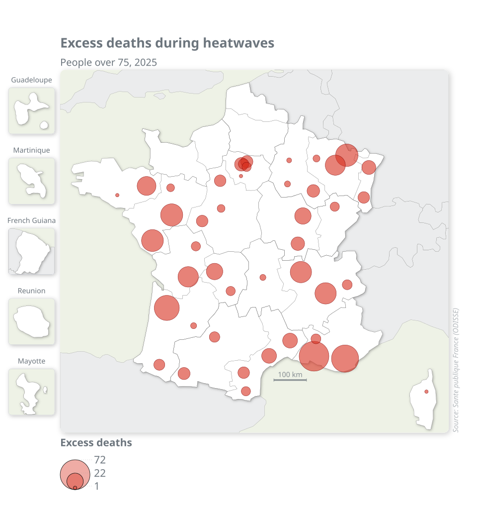
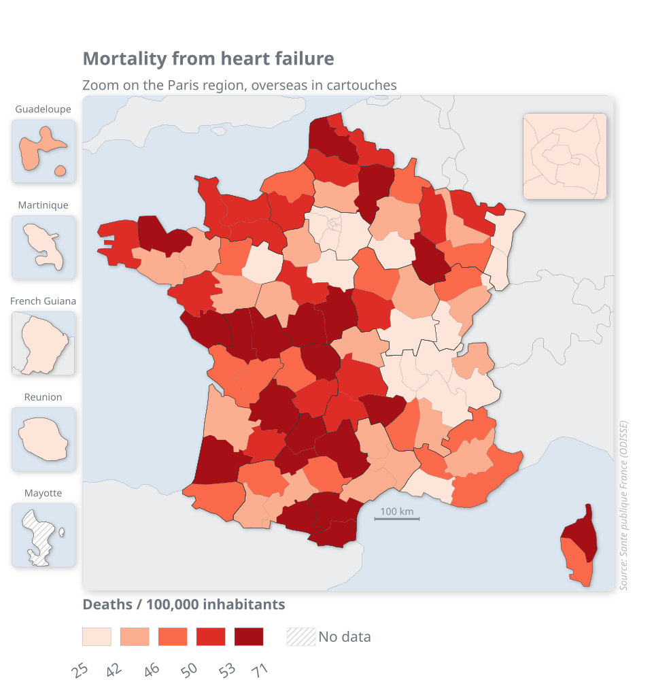

# mappyng

**SVG-native cartographic visualization library.**

`mappyng` turns GeoDataFrames into self-contained SVG maps, with no
matplotlib, no display server, and no GUI. The output is a plain `.svg`
file (or a standalone interactive HTML file). The SVG is the canonical
source; PNG and PDF export is derived from it.

<p align="center">
  
  
</p>

Documentation: https://fbxyz.github.io/mappyng/

## Gallery

| Globe | Proportional symbols | Zoom and cartouches |
|:---:|:---:|:---:|
|  |  |  |
| `Raster` relief in an orthographic projection | `Proportional` circles sized by a count | `Zoom` on a dense area, `Insets` and shadow |

The full gallery, with the code of every map, is in the
[documentation](https://fbxyz.github.io/mappyng/); the README images are
regenerated by `python docs/make_readme_images.py`.

## Installation

Install the latest version directly from the GitHub repository:

```bash
pip install git+https://github.com/fbxyz/mappyng.git
```

Optional extras:

```bash
pip install "mappyng[tile] @ git+https://github.com/fbxyz/mappyng.git"     # XYZ/raster basemap tiles (mercantile, Pillow)
pip install "mappyng[raster] @ git+https://github.com/fbxyz/mappyng.git"   # GeoTIFF raster backgrounds (rasterio)
pip install "mappyng[export] @ git+https://github.com/fbxyz/mappyng.git"   # PNG/PDF export (cairosvg)
```

A PyPI release (`pip install mappyng`) is planned.

## Quickstart

A map is composed by adding **layers** and **elements** (title, source,
scale bar...) to a `Map`. The bundled datasets provide ready-to-use
reference geometry:

```python
import mappyng as mp
from mappyng.data import load_france_departments

gdf = load_france_departments()

m = (
    mp.Map(gdf, width=800, height="auto", style="modern")
    + mp.Basemap()
    + mp.Title("Départements français")
    + mp.Source("Source : IGN, GéoFLA")
    + mp.ScaleBar()
)
m.render("departements.svg")
```

`width="auto"` / `height="auto"` size the canvas to the data so the map
is not letterboxed; `m.autosize()` recomputes it on demand.

`m + item` returns a new map and leaves `m` unchanged, so a shared base
can be derived into several maps. `m.add(item, ...)` adds in place and
returns the map, so calls can be chained:

```python
m = (
    mp.Map(gdf, width=800, height="auto")
    .add(mp.Basemap())
    .add(mp.Title("Départements français"))
)
```

To draw a choropleth, point a `Choropleth` layer at a value column. This
example is fully reproducible: the variable (`superficie_km2`, the area
of each metropolitan département) is computed from the bundled geometry
in Lambert-93 (EPSG:2154), so no external file is needed:

```python
import mappyng as mp
from mappyng.data import load_france_departments

gdf = load_france_departments()
gdf = gdf[gdf["COD_GEO"].str.len() == 2].copy()        # metropolitan France
gdf["superficie_km2"] = gdf.to_crs(2154).area / 1e6    # km²

m = (
    mp.Map(gdf, width=800, height="auto", style="modern")
    + mp.Basemap()
    + mp.Choropleth(gdf, column="superficie_km2", method="Quantiles",
                    num_classes=5, cmap="Blues",
                    legend=mp.Legend("Area (km²)"))
    + mp.Title("Area of the départements")
    + mp.Tooltip(["LIB_GEO", "superficie_km2"])
)
m.render("choropleth.svg")
```

With your own statistics, join them to the geometry on `COD_GEO` and
point `column=` at your column.

## Layers

| Layer | Purpose |
|---|---|
| `Basemap` | the base geometry outline |
| `Choropleth` | graduated colour by a value column |
| `Category` | colour by a category column |
| `Proportional` | proportional symbols (circles) |
| `Situation` | categorical symbols |
| `Label` | placed text labels (simulated annealing) |
| `Vector` | arbitrary vector overlay |
| `DropShadow` | blurred shadow under a set of geometries |
| `OceanGradient` | ocean gradient fading out from a coastline |
| `Graticule` | lat/lon grid |
| `Tile` | XYZ basemap tiles (extra `tile`) |
| `Raster` | GeoTIFF background (extra `raster`) |

Layers honour `z_index` (render order) and `visible`. A `Vector` with a
positive `z_index` is drawn above the data layers. `Choropleth` and
`Category` accept `legend=False` to hide their legend. Data layers are
drawn in the cartouches by default (`on_cartouches=False` to opt out).
The `...Layer` names of mappyng 1.x (`ChoroplethLayer`, `BasemapLayer`...)
were removed in 2.0; see the [changelog](CHANGELOG.md).

## Elements

| Element | Purpose |
|---|---|
| `Title` | title and subtitle |
| `Source` | source or credit line |
| `ScaleBar` | scale bar |
| `NorthArrow` | north arrow |
| `Insets`, `Inset` | cartouches (overseas territories, Alaska...) |
| `Zoom` | zoom window on a dense area |
| `Tooltip` | hover tooltips of the interactive export |
| `RadialGradient` | gradient fill, referenced with `fill=gradient.url` |
| `Legend` | legend settings, passed as a layer's `legend=` |

## Output

```python
m.render("map.svg")          # native SVG (canonical)
m.render("map.html")         # interactive HTML, tooltips from Tooltip
m.render("map.png", dpi=200) # PNG  (extra: export)
m.render("map.pdf")          # PDF  (extra: export)
```

## Serialisation

A map's intent (configuration, ordered layers, chrome) serialises to
YAML. Exported maps reference their geometry rather than inlining it, so
it is reattached on load:

```python
m.to_yaml("map.yaml")
m2 = mp.Map.from_yaml("map.yaml", gdf=gdf)   # renders an identical SVG
```

A hand-written document can instead declare where its data comes from
(a built-in `dataset` or a file `path`, with optional `crs`, `filter`,
and CSV `join`). It then builds with no Python at all:

```yaml
mappyng: 1
map: {width: 820, height: auto}
layers:
- type: Choropleth
  data:
    dataset: france_departments
    crs: 2154
    filter: COD_GEO.str.len() == 2
    join: {path: deaths.csv, left_on: COD_GEO, right_on: code_dep}
  params: {column: rate, cmap: RdBu, method: StdMean, num_classes: 7}
```

```bash
python -m mappyng map.yaml -o map.svg     # also .png, .pdf, .html
```

Loading a YAML executes its declared data sources (file reads, a pandas
`filter` expression), so only build documents you trust.

## Inspect and reproduce

After a map is built, each `Choropleth` / `Category` layer exposes a
`report` (method really applied, bounds, features per class, excluded
values, automatic adjustments), and `m.recipe("map.recipe.yaml")` records
the versions, the seed, the parameters and a fingerprint of the data. See
the guide *Inspecting and reproducing a map*. Measured render times and SVG
sizes are in the *Performance* guide.

## Design principles

- **Pure SVG**: no matplotlib; JavaScript only in the interactive export.
- **Warnings never block**: semiological advice is a warning, never an error.
- **Self-contained messages**: errors explain the cause and a way out.

## Development

```bash
pip install -e ".[dev]"      # tests, linters and the optional extras
pytest                       # test suite
ruff check src tests docs    # lint (correctness rules)
mypy                         # type check src/mappyng
```

Legend markup is covered by snapshot tests (`tests/snapshots/legends.json`).
After an intentional change to a legend, review the diff and regenerate them
with `UPDATE_SNAPSHOTS=1 pytest tests/test_legend_snapshots.py`.

## License

MIT.
